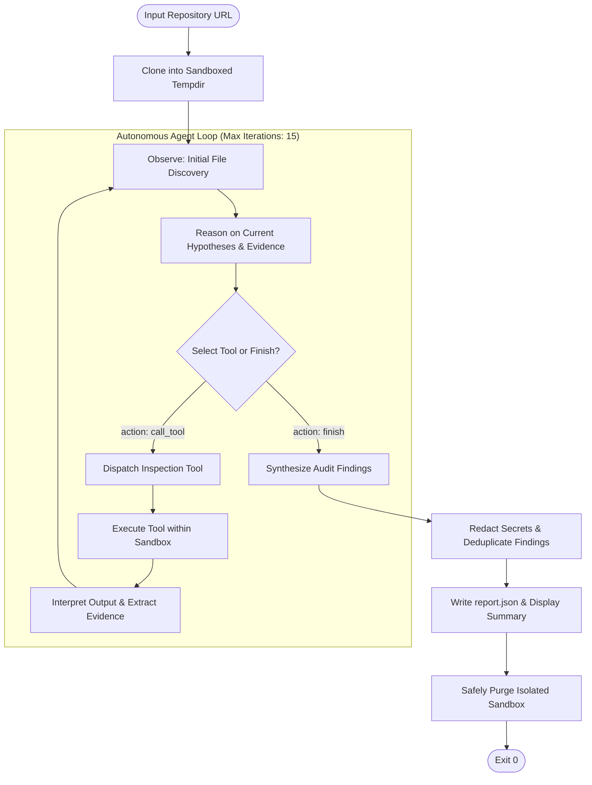

# Autonomous AI Agent for DevOps Repository Auditing

[](https://www.python.org/downloads/)
[](tests/)
[](#agent-architecture)
[](LICENSE)

An enterprise-grade, autonomous AI engineering agent built from first principles in Python to inspect GitHub repositories, uncover DevOps best-practice violations, verify empirical evidence, and generate machine-readable audit reports with actionable remediations.

---

## Table of Contents
1. [Executive Summary](#executive-summary)
2. [Agent Architecture & Reasoning Cycle](#agent-architecture--reasoning-cycle)
3. [DevOps Inspection Taxonomy](#devops-inspection-taxonomy)
4. [Evidence Standards & False Positive Mitigation](#evidence-standards--false-positive-mitigation)
5. [Security & Isolation Invariants](#security--isolation-invariants)
6. [Supported LLM Providers](#supported-llm-providers)
7. [Installation & Setup](#installation--setup)
8. [Execution Interface & Usage](#execution-interface--usage)
9. [JSON Output Contract](#json-output-contract)
10. [Automated Test Suite](#automated-test-suite)
11. [Project Structure](#project-structure)
12. [Author & Academic Attribution](#author--academic-attribution)

---

## Executive Summary

Traditional static code linters and fixed-checklist vulnerability scanners suffer from high false-positive rates and lack contextual reasoning. They fail to understand when an alternative configuration satisfies a requirement or when a subtle combination of CI triggers and permissions introduces a critical attack vector.

This system implements an **autonomous cognitive agent** that:
- Clones target repositories into an ephemeral, isolated sandbox without altering target state.
- Formulates hypotheses and selects inspection tools dynamically based on real-time observations.
- Validates findings against strict evidence rules to maximize both **Precision** and **Recall**.
- Automatically redacts credentials, access tokens, and private keys before emitting reports.
- Emits strictly typed, machine-readable JSON compliant with the evaluation contract.

> **Framework Restriction Compliance**: Built **100% from first principles** using native Python control flow, dynamic dispatch, and official LLM provider SDKs (`google-genai`, `openai`, `anthropic`). Prohibited monolithic agent frameworks (LangChain, LangGraph, n8n) are **strictly excluded**.

---

## Agent Architecture & Reasoning Cycle

The agent operates through an explicit, closed-loop cognitive cycle:



### Cognitive Cycle Stages
1. **Observe**: The agent inspects directory layout, configuration manifests, and workflow definitions.
2. **Reason**: The model identifies potential defect surfaces (e.g., untrusted PR triggers, missing lockfiles, exposed environment variables).
3. **Select Tool**: The agent selects the appropriate tool with targeted arguments (e.g., `search_code`, `read_file`, `git_log`, `inspect_ci_workflows`).
4. **Execute Tool**: The tool runs securely within repository boundaries, preventing path traversal attacks.
5. **Interpret Results**: Observations are fed back into context to guide follow-up inspections or falsify preliminary hypotheses.
6. **Report**: Upon exhausting inspection vectors, findings are synthesized into a verified, deduplicated JSON report.

---

## DevOps Inspection Taxonomy

The agent conducts structured investigations across 9 core software engineering and DevOps categories:

| Category | Canonical Rule IDs | Example Violations Checked |
| :--- | :--- | :--- |
| **Repository Hygiene** | `HYG-001`, `HYG-002`, `HYG-003` | Missing README; absent or inadequate `.gitignore`; tracked `__pycache__`, `.DS_Store`, build artifacts, `.env` files. |
| **Dependency Management** | `DEP-001`, `DEP-002`, `DEP-003` | Missing lockfiles (`poetry.lock`, `Pipfile.lock`, `package-lock.json`); unpinned wildcard `*` dependencies; conflicting package specifications. |
| **Code Quality** | `QUAL-001`, `QUAL-002` | Missing linter/formatter configurations (Ruff, Flake8, ESLint, Black); blatant maintainability defects; globally suppressed lint checks. |
| **Testing** | `TEST-001`, `TEST-002`, `TEST-003` | Missing automated test suite; test suite present but omitted from CI pipelines; ineffective test gates (`continue-on-error: true`). |
| **GitHub Actions / CI** | `CI-001` - `CI-005` | Absence of CI automation; dangerous `pull_request_target` triggers with untrusted checkout; excessive `permissions: write-all`; unpinned third-party actions; bypassed validation gates. |
| **Security** | `SEC-001`, `SEC-002`, `SEC-003` | Hardcoded API credentials/tokens (AWS, OpenAI, GitHub PAT); committed sensitive configs (`.env`, `credentials.json`); insecure remote script execution (`curl \| bash`). |
| **Configuration** | `CONF-001`, `CONF-002` | Hardcoded machine-specific absolute file paths (`/home/user`, `C:\Users`); committed local settings overrides (`local_settings.py`). |
| **Collaboration** | `COLLAB-001`, `COLLAB-002` | Unsafe PR auto-merge automation without review gates; missing PR templates or contributor guidance in public repositories. |
| **Build & Release** | `BLD-001`, `BLD-002` | Missing build validation jobs for deliverable packages/containers; unauthenticated release deployment workflows. |

---

## Evidence Standards & False Positive Mitigation

To score high marks on unseen test repositories (including mostly healthy reference repositories), the agent adheres to rigorous evaluation invariants:

1. **Equivalent Solution Invariant**: The absence of an optional file or tool is **never** treated as proof of a defect when an equivalent modern standard is used (e.g., `pyproject.toml` containing `[tool.ruff]` satisfies both linting and formatting; `uv.lock` satisfies dependency locking).
2. **Branch Protection Boundary Invariant**: Remote branch protection settings are managed by GitHub's control plane and cannot be reliably observed in local repository files. The agent **never** hallucinates branch protection violations from file content alone.
3. **Empty Report Validity**: For pristine, well-maintained repositories, an empty `violations: []` array is the intended and correct output. The agent does not fabricate issues to fill space.
4. **Secret Scrubbing Guarantee**: Raw secret values (e.g., `AKIA...`, `sk-...`, `ghp_...`, passwords) are **strictly scrubbed** and masked with tokens like `[REDACTED_AWS_KEY]` before inclusion in `evidence` or `description`.

---

## Security & Isolation Invariants

- **Read-Only Inspection**: Cloned repositories are strictly isolated in temporary directories created via `tempfile.mkdtemp()`. No write operations, commits, or git push commands are ever executed against the target.
- **Zero Untrusted Code Execution**: The auditor does not run arbitrary repository scripts, untrusted `setup.py`, or arbitrary executable binaries. All inspections are performed via safe static analysis, parsing, and regex pattern matching.
- **Path Traversal Protection**: All file read operations enforce strict relative path resolution against the sandbox root, rejecting directory escape attempts (`../`).
- **Resilient Cleanup**: Implements custom Windows and POSIX-compatible cleanup handlers (`_remove_readonly`) to guarantee temporary checkouts are cleanly unlinked upon process termination.

---

## Supported LLM Providers

The agent provides a pluggable LLM interface configured via environment variables or CLI flags:

| Provider | Supported Models | Required Environment Variable |
| :--- | :--- | :--- |
| **Google Gemini** *(Default)* | `gemini-2.5-flash`, `gemini-1.5-pro` | `GEMINI_API_KEY` |
| **OpenAI** | `gpt-4o`, `gpt-4o-mini` | `OPENAI_API_KEY` |
| **Anthropic** | `claude-3-5-sonnet-20241022`, `claude-3-haiku-20240307` | `ANTHROPIC_API_KEY` |
| **Groq / OpenRouter** | `llama-3.3-70b-versatile`, custom endpoints | `GROQ_API_KEY` / `OPENAI_API_KEY` |
| **Mock / Offline** | Deterministic scripted client for zero-cost testing | None (runs completely offline) |

---

## Installation & Setup

### Prerequisites
- Python 3.10 or higher
- Git 2.30+ installed and available in `PATH`

### 1. Clone the Repository
```bash
git clone https://github.com/i230077-cloud/i230077_A_A2_MLOps.git
cd i230077_A_A2_MLOps
```

### 2. Create and Activate a Virtual Environment
```bash
# On Linux / macOS
python -m venv venv
source venv/bin/activate

# On Windows (PowerShell)
python -m venv venv
.\venv\Scripts\Activate.ps1
```

### 3. Install Dependencies
```bash
pip install -r requirements.txt
```

### 4. Configure API Credentials
Copy `.env.example` to `.env` and insert your desired provider API key:
```bash
cp .env.example .env
```
Edit `.env`:
```ini
GEMINI_API_KEY=your_actual_gemini_api_key_here
DEFAULT_LLM_PROVIDER=gemini
DEFAULT_LLM_MODEL=gemini-2.5-flash
```

---

## Execution Interface & Usage

### Standard Unattended Execution (Required Contract)
The agent strictly follows the mandated evaluation command:
```bash
python agent.py --repo <github_repository_url> --output report.json
```

#### Example: Auditing a Remote Public Repository
```bash
python agent.py --repo https://github.com/example/demo-project --output report.json
```

#### Example: Selecting a Specific LLM Provider and Model
```bash
# Use OpenAI GPT-4o-mini
python agent.py --repo https://github.com/example/demo-project --output report.json --provider openai --model gpt-4o-mini

# Use Anthropic Claude 3.5 Sonnet
python agent.py --repo https://github.com/example/demo-project --output report.json --provider anthropic --model claude-3-5-sonnet-20241022
```

#### Example: Running Offline / Mock Mode (Zero API Key / CI Testing)
```bash
python agent.py --repo https://github.com/example/demo-project --output report.json --mock
```

#### Example: Quiet Mode (Automated Pipelines)
```bash
python agent.py --repo https://github.com/example/demo-project --output report.json --quiet
```

---

## JSON Output Contract

The generated output file strictly adheres to the schema specification:

```json
{
  "repository": "https://github.com/example/demo-project",
  "violations": [
    {
      "rule_id": "SEC-001",
      "category": "security",
      "severity": "critical",
      "file": "config.py",
      "line": 17,
      "description": "Hardcoded API credential",
      "evidence": "Credential assigned directly in source code: API_KEY = '[REDACTED_API_KEY]'",
      "recommendation": "Use a secrets manager or environment variable instead of committing credentials."
    },
    {
      "rule_id": "CI-002",
      "category": "github actions / ci",
      "severity": "critical",
      "file": ".github/workflows/pr_check.yml",
      "line": 12,
      "description": "Dangerous workflow trigger with untrusted PR checkout",
      "evidence": "Workflow triggers on pull_request_target and checks out pull request head ref.",
      "recommendation": "Change trigger to pull_request or isolate privileged operations to separate workflows."
    },
    {
      "rule_id": "DEP-001",
      "category": "dependency management",
      "severity": "high",
      "file": "pyproject.toml",
      "line": null,
      "description": "Missing dependency lockfile",
      "evidence": "Poetry project configuration present in pyproject.toml but poetry.lock is missing.",
      "recommendation": "Run 'poetry lock' and commit the resulting poetry.lock file to version control."
    }
  ]
}
```

### Schema Integrity Guarantees
- **Allowed Severities**: `critical`, `high`, `medium`, `low`.
- **Nullable File & Line**: Properly represented as JSON `null` when a violation applies to the overall repository.
- **Redacted Secrets**: Secret tokens are sanitized to prevent credential leakage.

---

## Automated Test Suite

The repository contains an exhaustive automated test suite validating tools, sanitizers, agent loops, and CLI integration.

Run the test suite with `pytest`:
```bash
pytest -v
```

### Test Coverage Highlights
- **`tests/test_tools.py`**: Validates `list_files`, `read_file`, `search_code`, `git_log`, `git_status`, `inspect_ci_workflows`, and `check_dependencies`. Tests path traversal rejection and file slicing.
- **`tests/test_sanitizer.py`**: Verifies pattern redaction for AWS, OpenAI, GitHub PAT, Slack, Stripe, and private keys. Validates deduplication and schema normalization.
- **`tests/test_agent_loop.py`**: Verifies dynamic tool dispatching, multi-turn reasoning, and graceful recovery from tool execution errors.
- **`tests/test_cli.py`**: End-to-end integration test validating CLI flags, error codes, and strict JSON output generation.

---

## Project Structure

```
├── .env.example              # Sample environment variable configuration
├── .gitignore                # Clean production ignore definitions
├── LICENSE                   # Open-source license
├── README.md                 # Complete documentation and setup guide
├── pyproject.toml            # Project metadata and tool configuration
├── requirements.txt          # Installable Python dependencies
├── sample_report.json        # Authentic example audit report
├── agent.py                  # CLI entry point (supports --repo and --output)
├── tools.py                  # Core inspection tool implementations & schemas
├── agent/                    # Modular Agent Engine (Zero Frameworks)
│   ├── __init__.py           # Package initializer
│   ├── core.py               # ReAct reasoning loop & tool dispatcher
│   ├── prompts.py            # Cognitive system instructions & schema format
│   ├── providers.py          # Multi-provider LLM interface (Gemini, OpenAI, Anthropic, Mock)
│   ├── repo_manager.py       # Isolated git cloning, sandboxing, & cleanup
│   ├── rules.py              # Canonical DevOps audit rules taxonomy
│   ├── sanitizer.py          # Secret redaction & violation deduplication
│   └── schema.py             # Pydantic models & validation logic
└── tests/                    # Comprehensive automated test suite
    ├── __init__.py
    ├── test_agent_loop.py    # Agent reasoning cycle tests
    ├── test_cli.py           # CLI invocation & report creation tests
    ├── test_sanitizer.py     # Secret scrubbing & deduplication tests
    └── test_tools.py         # Tool sandboxing & path protection tests
```

---

## Author & Academic Attribution

- **Course**: MLOps & Production AI Engineering
- **Assignment**: Assignment 2 — Build an AI Agent for DevOps Repository Auditing
- **Student Name**: Muhammad Saad
- **Student ID**: i230077
- **GitHub**: [i230077-cloud](https://github.com/i230077-cloud)
- **Repository URL**: [https://github.com/i230077-cloud/i230077_A_A2_MLOps](https://github.com/i230077-cloud/i230077_A_A2_MLOps)
